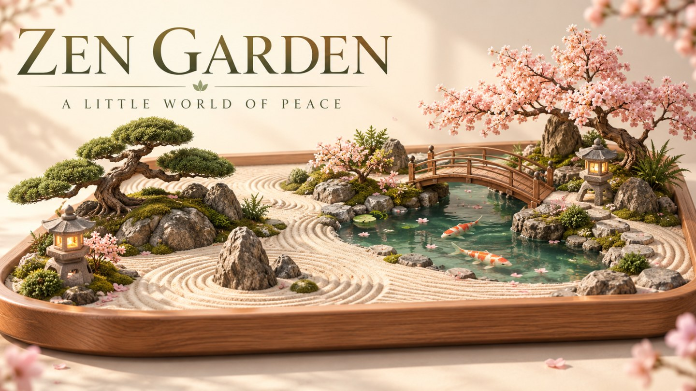

# Zen Garden — A Little World of Peace

A small, self-contained 3D garden builder for a quieter moment. Arrange sculpted stones and trees, draw your own sand patterns, change the weather, and save a photograph of your little world.



## Play

Designed for **https://play2earn.world/zen-garden/**. The deployable package is entirely static: no account, database, API key, or Node.js hosting process.

- Seven original placeable objects: river stones, cloud bonsai, cherry blossom, flowers, stone lantern, koi pond, and arched bridge.
- Placement preview, quarter-unit snapping, footprint validation, dragging, rotation, removal, undo/redo, and confirmed reset.
- Persistent freehand sand grooves with an efficient drawing texture.
- Sunny morning, golden evening, moonlit night, and gentle rain.
- Original synthesized bird, wind, water, and rain ambience with explicit sound activation, mute, and volume.
- Local autosave, three graphics presets, adaptive resolution, bounded zoom, and PNG photo download.

## Responsive design

The canvas and controls occupy separate CSS Grid regions. Phone portrait uses a bottom tray; tablet portrait uses the full garden width; desktop and phone landscape use a side tray. No whole-interface scaling or canvas stretching is used.

An orthographic camera projects the actual scene mesh bounds into camera space and fits them to the **available canvas area** with safe margins. ResizeObserver responds to changing toolbars and viewport changes. Framing is recalculated after edits and photo-angle changes. Zoom only moves out from this safe framing.

## Develop

Node.js **24+** is required for the full test workflow.

```sh
npm ci
npm run dev
npm test
npm run build
npm run preview
```

The development server opens at port 5260. The production preview serves the exact subdirectory route at `http://127.0.0.1:5260/zen-garden/`. Do not run development and production preview simultaneously on the same port.

## Tests

```sh
npm test
npx playwright install chromium
npm run test:browser
```

The Playwright suite covers twelve viewport sizes, bounds-based framing diagnostics, visible 44px controls, overflow, placement, movement, undo/redo, saves, reloads, screenshots, and browser errors. It includes Chromium touch-event drags for mobile-sized viewports. `GAME_URL` can point it at an already running HTTP preview.

See [TEST-RESULTS.md](TEST-RESULTS.md) for what was actually run in this workspace and the remaining device/browser limits. Viewport emulation is not a physical phone performance benchmark.

## Deploy

Extract `zen-garden-cpanel.zip` directly into `public_html/zen-garden/`. See [DEPLOYMENT.md](DEPLOYMENT.md) for cPanel and Pages instructions. The build uses relative assets; no routing fallback is needed.

The Pages workflow is manual. Connect this source to your GitHub repository, choose GitHub Actions as the Pages source, and run the workflow. The source repository is [p2e-source/zengarden](https://github.com/p2e-source/zengarden). Repository owners can enable Pages with GitHub Actions and manually run the included workflow.

## Structure

- `src/state.ts`: validated layout, collision rules, and transactional undo history.
- `src/models.ts`: original assembled miniature models and reusable materials.
- `src/scene.ts`: Babylon rendering, sand texture, camera fitting, weather, quality, and photo export.
- `src/main.ts`: responsive UI, Pointer Events, gestures, storage, and accessibility.
- `src/sound.ts`: original Web Audio ambience.
- `tests/`: unit tests, browser specifications, and recorded responsive checks.

## Licenses and artwork

Source and original procedural models: MIT. Babylon.js: Apache-2.0, with bundled license notices. DM Sans: SIL Open Font License, bundled with the font. All assets run locally; there are no external model, texture, font, or audio requests.

The cover/social artwork was generated using OpenAI ImageGen as original promotional illustration. It is **not a gameplay screenshot**. Real screenshots are under `screenshots/`. No third-party game models or commercial sampled audio are used.

[More free games at Play2Earn.world](https://play2earn.world/)
